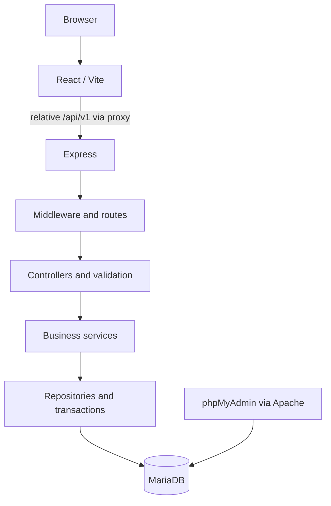

# Application architecture

Approved design baseline: Steps 3.2–3.3, 28 November 2026. Implementation not started.

## Stack and boundaries
- Client: React 19, TypeScript, Vite, Tailwind CSS 4, React Router, TanStack Query, React Hook Form, Zod, Lucide React. Vitest, React Testing Library and Playwright.
- Server: Node.js, Express 5, TypeScript, mysql2, Zod, Argon2id, Express Session, Helmet, Express Rate Limit, Decimal.js, Pino, Nodemailer, TSX, Vitest, Supertest. OpenAPI/Swagger. SQL migrations.
- Shared: npm lockfiles, ESLint, Prettier, GitHub Actions when configured. Exact dependency versions and package layout to be locked at P01; do not install everything up front.
- Local database: existing XAMPP MariaDB, InnoDB, utf8mb4, phpMyAdmin. Local synthetic data only; supported database required for production. Installed version and connection settings are maintained privately.
- Runtime: Node 24 LTS recommended common baseline. Align both developers and verify packages before dependency lock; installed machine versions are recorded privately.

## Communication

The diagram is for same-machine development. For separate PCs use a specifically authorized private development connection or run the reviewed backend locally; do not expose DB/phpMyAdmin or public ports. Production: HTTPS same-origin reverse proxy serves client build and routes `/api/v1` to private Express; database remains private. Hosting not selected.

## Source organization
Single root repo `commonolivesofts-create/olive-billing`. Client owner Frontend developer; server owner Backend developer; docs jointly reviewed. No nested Git repositories.

`client/src/`: app, assets, components/ui, components/common, layouts, features, hooks, services, styles, types, utils, tests, main.tsx. `server/src/`: config, database, middleware, modules, routes, utils, constants, jobs, types, app.ts, server.ts. Each business module uses routes, controller, service, repository, validation and types as needed. `server/migrations/` and `server/tests/` separate. Create directories incrementally, not empty scaffolding for all features.

## Environment
Development listener and proxy settings come from environment configuration; API prefix `/api/v1`; business timezone Asia/Kolkata, stored timestamps UTC. No external database installation or existing XAMPP configuration changes. Environment-specific secrets never in client. PDF renderer and database-backed recurring job design to be selected when applicable. Modular monolith; no microservices, external broker, Redis or Kubernetes required.
