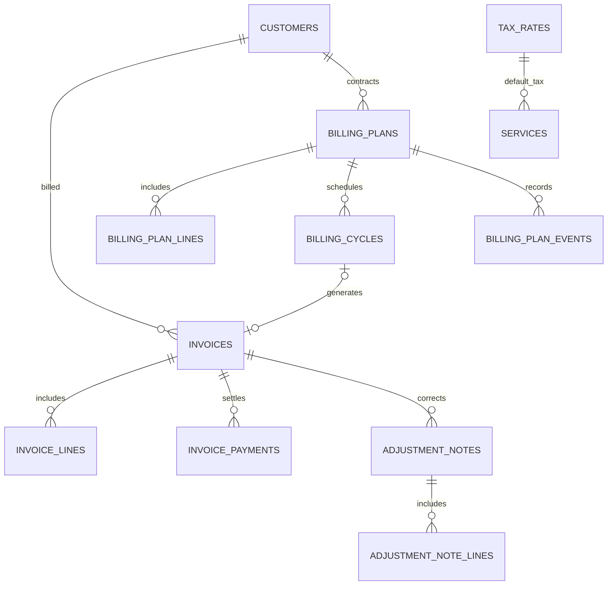

# Core relationships

Conceptual ERD; exact constraints and introduction order reviewed with migrations.

Nullable links: invoices.billing_plan_id and source_invoice_id; billing_plans.predecessor_plan_id; billing_cycles.invoice_id unique if populated; optional previous_invoice_reference. Service references and bank references as defined in source; preserve snapshots. Document, email and IRN owner is exactly one invoice or adjustment note; enforce ownership and linkage in DB and service. No circular DDL dependency: defer references to later-created tables until both exist.
